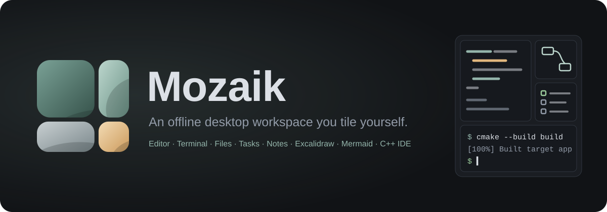
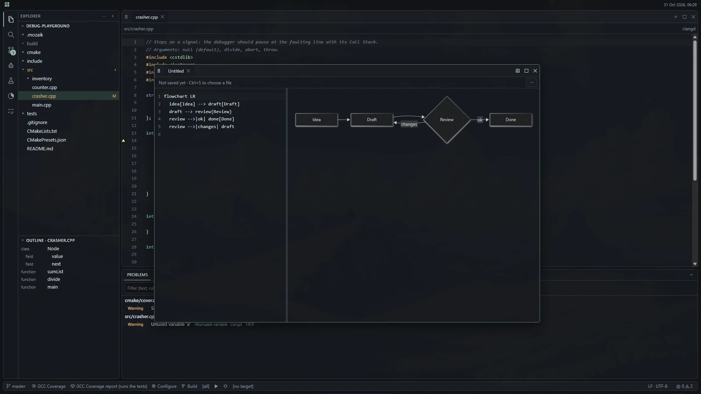
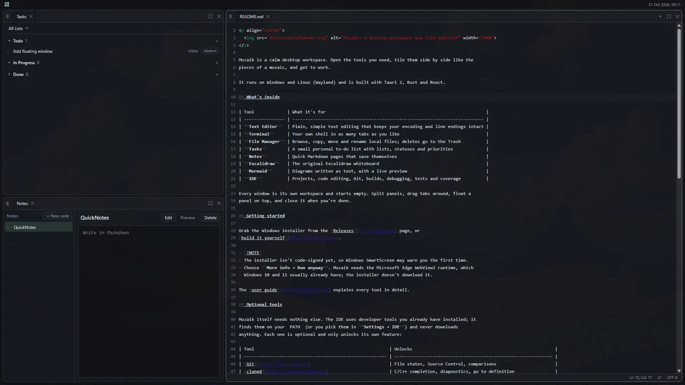
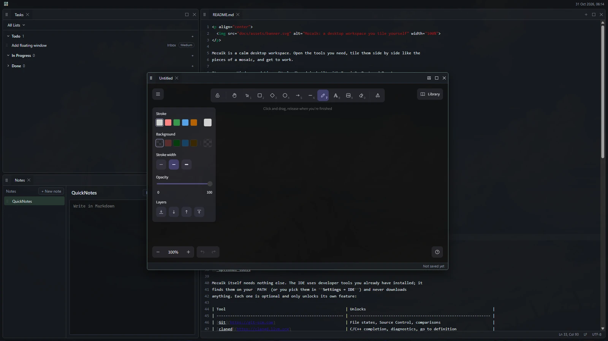
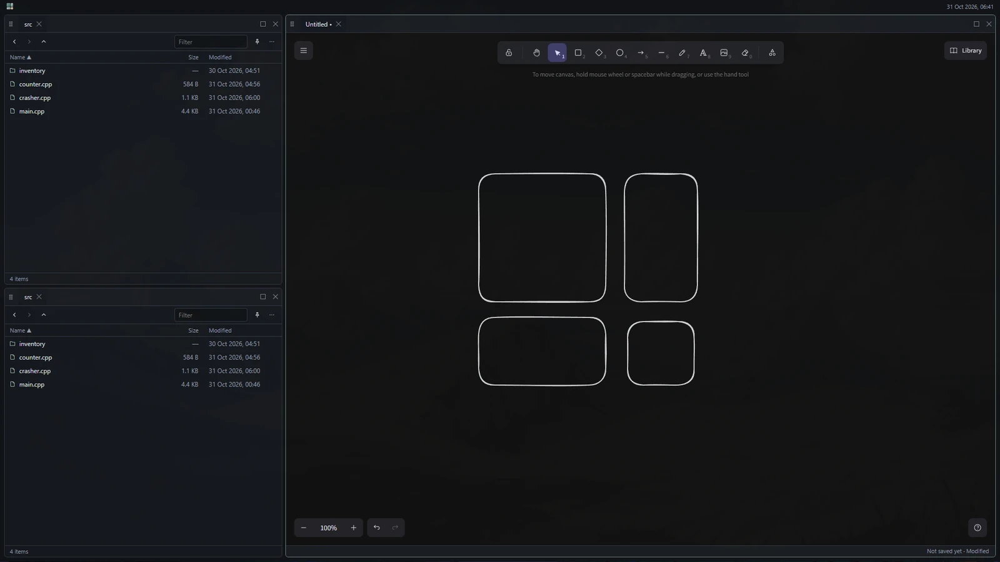
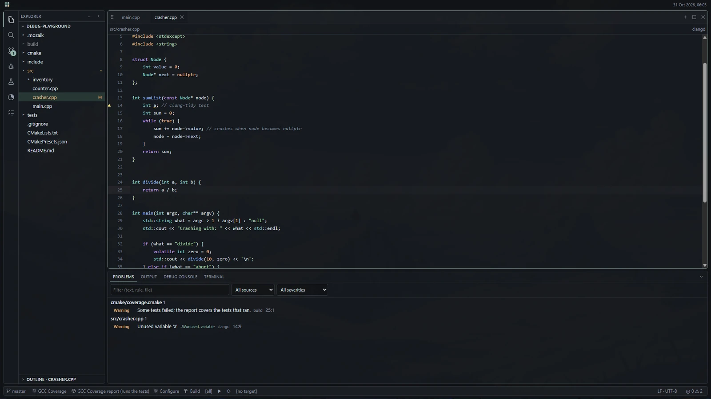

<p align="center">
  
</p>

Mozaik is a calm desktop workspace. Open the tools you need, tile them side by side like the
pieces of a mosaic, and get to work.

It runs on Windows and Linux (Wayland) and is built with Tauri 2, Rust and React.

## What's inside

| Tool             | What it's for                                                               |
| ---------------- | --------------------------------------------------------------------------- |
| **Text Editor**  | Plain, simple text editing that keeps your encoding and line endings intact |
| **Terminal**     | Your own shell in as many tabs as you like                                  |
| **File Manager** | Browse, copy, move and rename local files; deletes go to the Trash          |
| **Tasks**        | A small personal to-do list with lists, statuses and priorities             |
| **Notes**        | Quick Markdown pages that save themselves                                   |
| **Excalidraw**   | The original Excalidraw whiteboard                                          |
| **Mermaid**      | Diagrams written as text, with a live preview                               |
| **IDE**          | Projects, code editing, Git, builds, debugging, tests and coverage          |

Every window is its own workspace and starts empty. Split panels, drag tabs around, float a
panel on top, and close it when you're done.

## A look around

<p align="center">
  <a href="docs/assets/screenshots/mozaik-4.webp"></a>
  <br><sub>The IDE with a floating Mermaid diagram</sub>
</p>

<table>
  <tr>
    <td width="50%"><a href="docs/assets/screenshots/mozaik-1.webp"></a><br><sub>Tasks, Notes and the Text Editor side by side</sub></td>
    <td width="50%"><a href="docs/assets/screenshots/mozaik-2.webp"></a><br><sub>A floating Excalidraw panel over the layout</sub></td>
  </tr>
  <tr>
    <td width="50%"><a href="docs/assets/screenshots/mozaik-3.webp"></a><br><sub>File Managers next to a drawing</sub></td>
    <td width="50%"><a href="docs/assets/screenshots/mozaik-5.webp"></a><br><sub>Explorer, code editor and Problems</sub></td>
  </tr>
</table>

## Getting started

Grab the Windows installer from the [Releases](../../releases) page, or
[build it yourself](#build-from-source).

> [!NOTE]
> The installer isn't code-signed yet, so Windows SmartScreen may warn you the first time.
> Choose **More info → Run anyway**. Mozaik needs the Microsoft Edge WebView2 runtime, which
> Windows 10 and 11 usually already have; the installer doesn't download it.

The [user guide](docs/USER_GUIDE.md) explains every tool in detail.

## Optional tools

Mozaik itself needs nothing else. The IDE uses developer tools you already have installed; it
finds them on your `PATH` (or you pick them in **Settings → IDE**) and never downloads
anything. Each one is optional and only unlocks its own feature:

| Tool                                                     | Unlocks                                                        |
| -------------------------------------------------------- | -------------------------------------------------------------- |
| [Git](https://git-scm.com)                               | File states, Source Control, comparisons                       |
| [clangd](https://clangd.llvm.org)                        | C/C++ completion, diagnostics, go to definition                |
| [CMake](https://cmake.org) and a compiler                | Configure, build, run and test (MSVC, MinGW GCC, Clang or GCC) |
| [GDB](https://www.sourceware.org/gdb/) 14+ or `lldb-dap` | Debugging (GDB needs Python; MSVC builds can't be debugged)    |
| [clang-tidy](https://clang.llvm.org/extra/clang-tidy/)   | Code analysis and quick fixes                                  |
| gcovr or llvm-cov (run from your own CMake target)       | Coverage reports Mozaik can show                               |

## Build from source

You need [Node.js](https://nodejs.org) 22.12 or newer and stable [Rust](https://rustup.rs).

- **Windows:** Visual Studio C++ Build Tools with the Windows SDK, and WebView2.
- **Linux:** WebKitGTK 4.1 and its friends, for example on Ubuntu/Debian:
  `sudo apt install libwebkit2gtk-4.1-dev build-essential libssl-dev libayatana-appindicator3-dev librsvg2-dev patchelf`

See [Tauri's prerequisites](https://v2.tauri.app/start/prerequisites/) if anything is missing.

```sh
npm ci
npm run tauri dev                         # run the app
npm run tauri build -- --bundles nsis     # Windows installer
npm run tauri build -- --bundles deb,appimage   # Linux packages (run on Linux)
```

On PowerShell with script execution disabled, use `npm.cmd` instead of `npm`.

## Security

Mozaik only starts programs you ask for: your shell in a Terminal, and in the IDE the tools
listed above. A PowerShell terminal also runs the prompt file you chose in Settings → Terminal
(an example is in [examples/powershell](examples/powershell/path-venv-git-prompt.ps1)). The File Manager won't launch programs or scripts. Settings, tasks and notes live
in your local app data folder.

## Status

The current release is **v0.9.0**. It's developed and tested on Windows, where the automated
tests pass. Linux Wayland builds and several native flows (dialogs, drag and drop, the
installer) haven't been checked by hand yet, so expect rough edges there. [STATUS](docs/STATUS.md) and [VALIDATION](docs/VALIDATION.md) track
exactly what has been verified, and [docs/decisions](docs/decisions/) explains why things work
the way they do.

Found a bug or have an idea? Please open an issue.

## Contributing

```sh
npm test                 # unit tests
npm run test:e2e         # browser interaction tests
npm run test:production  # checks the production build loads only bundled assets
npm run format:check
cargo test --manifest-path src-tauri/Cargo.toml
cargo clippy --manifest-path src-tauri/Cargo.toml --all-targets -- -D warnings
```

On Linux, run `npx playwright install --with-deps chromium` before the browser tests.
[AGENTS.md](AGENTS.md) describes the architecture and the rules the code follows.

## License

Mozaik is free software under the [GNU General Public License v3.0 or later](LICENSE). It
builds on many open-source projects; see [THIRD_PARTY_NOTICES.md](THIRD_PARTY_NOTICES.md).
